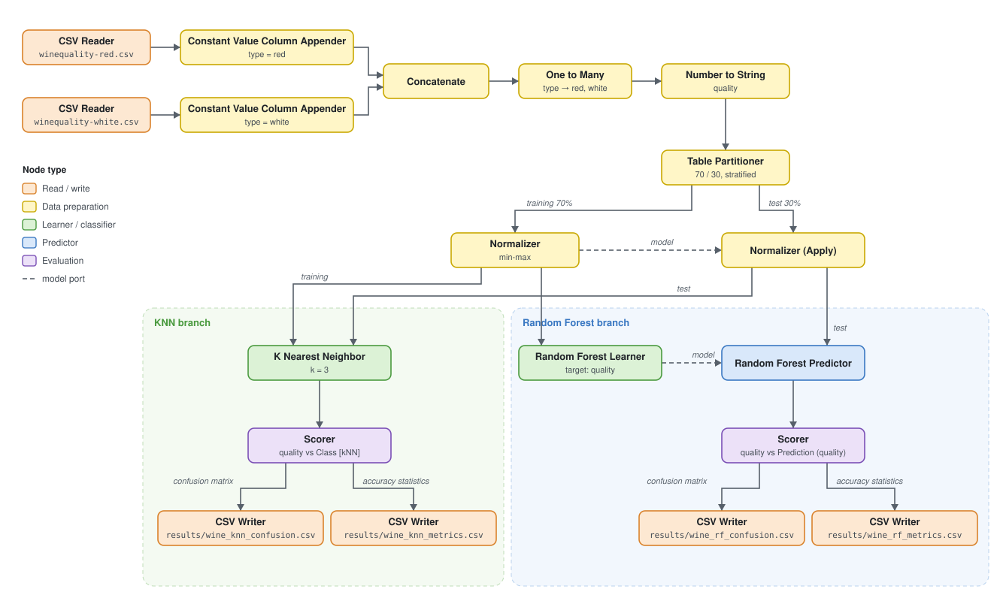
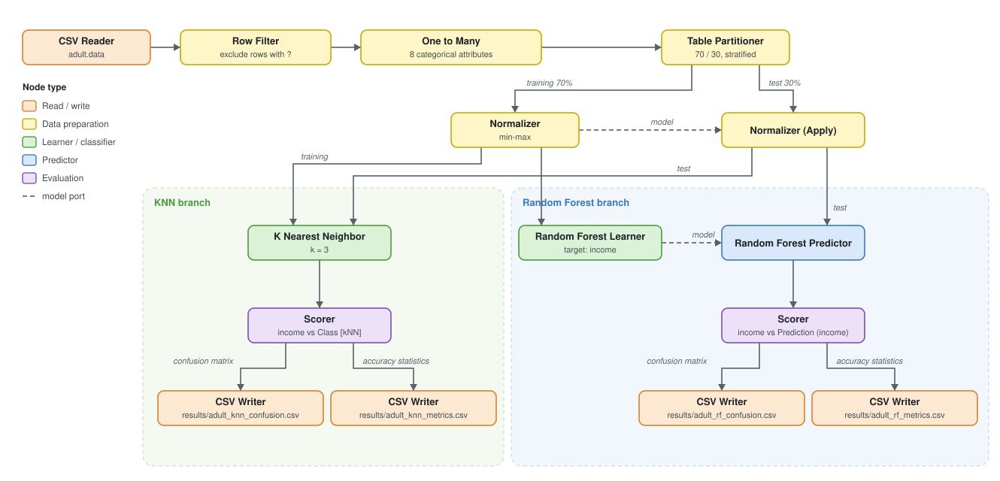

# KNIME guide: KNN vs Random Forest on Wine and Adult

Step-by-step instructions to build the two workflows in KNIME 5.12. Terms (Wine, Adult, Target, Partition, Result…) are defined in [GLOSSARY.md](../GLOSSARY.md).

Every node keeps its **default settings** unless a step says otherwise.

In the paths below, `<repo>` means `/home/artmear/Desktop/workshop`.

## 0. Clean up the workspace

1. Close every open workflow.
2. In the KNIME Explorer, delete `wine_quality_knn` (it is empty).
3. Rename `wine_quality_random_tree` to `wine`.

## 1. Wine workflow

Open `wine`. Most of the chain already exists:

### 1.1 Point the readers at the repo

- **CSV Reader (#1):** file `<repo>/datasets/wines/winequality-red.csv`.
- **CSV Reader (#2):** file `<repo>/datasets/wines/winequality-white.csv`.

The delimiter `;` is detected automatically.

### 1.2 Check the Partition

**Table Partitioner:** Relative 70%, **Stratified** on `quality`, fixed random seed. This is already set; just confirm it.

### 1.3 Add the KNN branch

1. Add a **K Nearest Neighbor** node.
   - Top input (training data) ← output of **Normalizer**.
   - Bottom input (test data) ← output of **Normalizer (Apply)**.
   - Settings: class column `quality`, k = 3 (default).
2. Add a **Scorer** after it: first column `quality`, second column `Class [kNN]`.

### 1.4 Check the Random Forest branch

- **Random Forest Learner:** Target column `quality`, defaults (100 models).
- **Scorer:** first column `quality`, second column `Prediction (quality)`.

### 1.5 Write the Results

Each Scorer has two outputs:
- **Top:** the confusion matrix.
- **Bottom:** the accuracy statistics (accuracy, Cohen's kappa, per-class values).

Connect a **CSV Writer** to each output (4 writers in total). Use these settings on every writer:
- Tick **Write RowIDs**, because the RowIDs hold the class names and the "Overall" row.
- Set **If exists** to **Overwrite** (the default is Fail).
- Tick **Create missing folders**.

| Scorer | Output | File |
| --- | --- | --- |
| KNN | top | `<repo>/results/wine_knn_confusion.csv` |
| KNN | bottom | `<repo>/results/wine_knn_metrics.csv` |
| Random Forest | top | `<repo>/results/wine_rf_confusion.csv` |
| Random Forest | bottom | `<repo>/results/wine_rf_metrics.csv` |

## 2. Adult workflow

Create a new workflow called `adult` and add these nodes in order. The finished workflow looks like this:

### 2.1 CSV Reader

- **File:** `<repo>/datasets/adults/adult.csv`
- **Column delimiter:** `,` (detected automatically).
- **Has column header:** on.

`adult.csv` is `adult.data` converted to a regular CSV: it has a header row with the column names and no leading spaces. Missing values are still written as `?`.

Expected: 32 561 rows, 15 columns.

### 2.2 Row Filter: remove Missing values

In Adult, missing values are written as the text `?`. They only appear in three columns.

- Match: **Any criterion**
- Criteria: `workclass` = `?`, `occupation` = `?`, `native-country` = `?`
- **Filter behavior** (scroll down, below the criteria): **Output non-matching rows**.

Expected: 30 162 rows left.

### 2.3 One to Many

- Columns: `workclass, education, marital-status, occupation, relationship, race, sex, native-country`. These are all categorical Attributes; **not** `income`.
- Tick **Remove included columns**, same as in Wine.

### 2.4 Table Partitioner

Relative 70%, **Stratified** on `income`, fixed random seed.

### 2.5 Normalizer + Normalizer (Apply)

- **Normalizer:** Min-Max, 0 to 1, all numeric columns. Input: the top (training) output of the Partitioner.
- **Normalizer (Apply):** model from the Normalizer, data from the bottom (test) output of the Partitioner.

### 2.6 KNN branch

- **K Nearest Neighbor:** training ← Normalizer, test ← Normalizer (Apply). Class column `income`, k = 3.
  It can take a minute: about 21 000 training rows × about 100 columns.
- **Scorer:** first column `income`, second column `Class [kNN]`.

### 2.7 Random Forest branch

- **Random Forest Learner:** input ← Normalizer, Target column `income`, defaults.
- **Random Forest Predictor:** model ← Learner, data ← Normalizer (Apply).
- **Scorer:** first column `income`, second column `Prediction (income)`.

### 2.8 Write the Results

Add 4 CSV Writers with the same settings as in 1.5:

- `<repo>/results/adult_knn_confusion.csv`
- `<repo>/results/adult_knn_metrics.csv`
- `<repo>/results/adult_rf_confusion.csv`
- `<repo>/results/adult_rf_metrics.csv`

## 3. Run and export

1. **Execute all** in both workflows. `<repo>/results/` should now hold 8 files.
2. Export each workflow:
   - Right-click it in the Explorer → **Export KNIME Workflow…**
   - Destination: `<repo>/workflows/wine.knwf` and `<repo>/workflows/adult.knwf`.
   - Tick **Reset workflow before export**, so the files stay small. The Results are already in `results/`.
3. Tell Claude. It reads `results/` and writes `report.md`.
