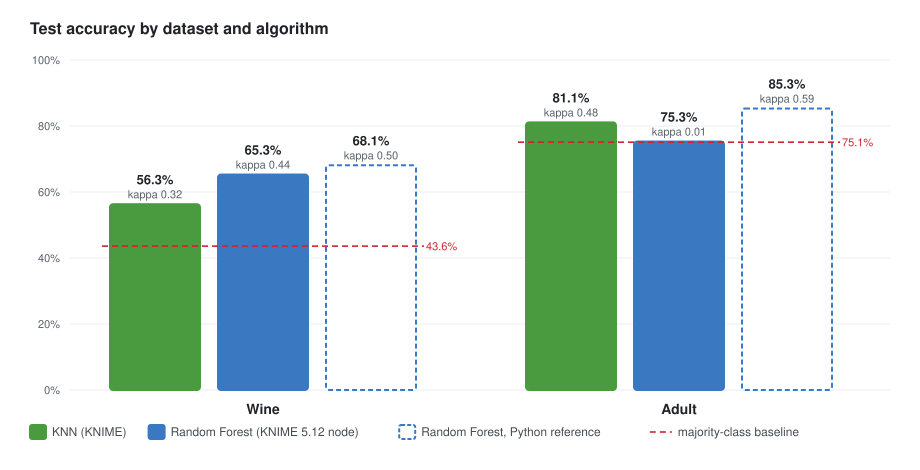
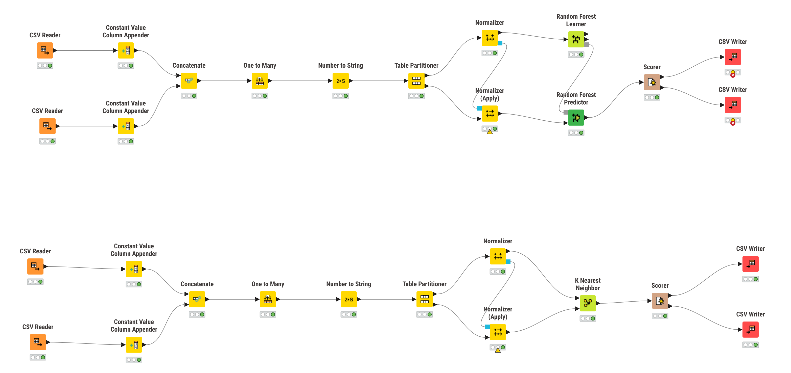
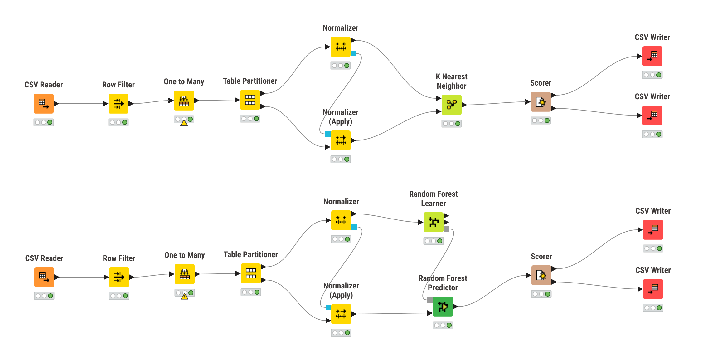

# KNN vs Random Forest on Wine and Adult

KNIME workshop report. Two classification algorithms, **KNN** and **Random Forest**, are run with default settings on two datasets with very different characteristics. The goal is to discuss *why* each algorithm does better or worse on each dataset. Terms such as Attribute, Target, Partition, Result and Baseline are defined in [GLOSSARY.md](GLOSSARY.md).



**Summary**

- **Wine:** Random Forest beats KNN clearly, with 65.3% vs 56.3% accuracy (kappa 0.44 vs 0.32).
- **Adult, KNN:** reaches 81.1% (kappa 0.48), well above the 75.1% Baseline.
- **Adult, Random Forest:** collapses to the Baseline in KNIME (75.3%, kappa 0.01), because of how the KNIME 5.12 *Random Forest Learner* node is configured (section 4.3). A standard random forest built in Python on the same preparation reaches about 85%, which would make it the best model on Adult as well.

## 1. Datasets

| | Wine | Adult |
| --- | --- | --- |
| Source files | `winequality-red.csv` + `winequality-white.csv` | `adult.data` (as `adult.csv`) |
| Rows | 6 497 (1 599 red + 4 898 white) | 32 561 → **30 162** after removing Missing values |
| Attributes | 12: **11 numeric** + wine type (categorical, 2 values) | 14: **6 numeric** + **8 categorical** |
| Attributes after preparation | 13 numeric (type → `red`, `white`) | **108** numeric (6 numeric + 102 one-hot columns) |
| Missing values | none | `?` in `workclass` (1 836), `occupation` (1 843), `native-country` (583); 2 399 rows (7.4%) affected |
| Target | `quality`, 7 classes (3–9), ordinal | `income`, 2 classes (`<=50K`, `>50K`) |
| Target distribution | 3: 30 · 4: 216 · 5: 2 138 · **6: 2 836** · 7: 1 079 · 8: 193 · 9: 5 | **`<=50K`: 22 654 (75.1%)** · `>50K`: 7 508 (24.9%) |
| Partition (train / test) | 4 547 / 1 950 | 21 113 / 9 049 |
| Baseline (test) | 43.6% (always predict 6) | 75.1% (always predict `<=50K`) |

**What changes between the two datasets:**

- **Attribute types:**
  - Wine is almost entirely numeric and has few Attributes.
  - Adult is mostly categorical, with 8 categorical Attributes that take 2 to 42 values each (`native-country`). One-hot encoding turns 14 Attributes into 108 columns, most of them sparse 0/1 columns that are almost always 0.
  - Four of the 108 columns are always 0: the three `?` values and `workclass = Never-worked`. They only occur in rows that the Row Filter removed, but One to Many still creates them from the reader's list of possible values.
- **Size:** Adult has about 5 times more rows.
- **Target:** Wine has 7 imbalanced, ordered classes. Two of them, grades 3 and 9, have only 9 and 2 wines in the test set. Adult has one binary, imbalanced Target.
- **Data quality:** only Adult has Missing values, and those rows are removed.

## 2. Methodology

Each dataset has its own KNIME workflow ([`workflows/wine.knwf`](workflows/wine.knwf) and [`workflows/adult.knwf`](workflows/adult.knwf)). The node-by-node build is in [`docs/knime-guide.md`](docs/knime-guide.md).

**Wine workflow in KNIME** (top: Random Forest branch, bottom: KNN branch)



**Adult workflow in KNIME** (top: KNN branch, bottom: Random Forest branch)



The images are rendered from the `workflow.svg` file that KNIME saves in each workflow folder, using [`scripts/knime_svg_to_png.py`](scripts/knime_svg_to_png.py). In the Wine image, the two CSV Writers of the Random Forest branch show an error. They are set to "If exists: Fail" and the last run found the files from the first run already there. The Random Forest Results in `results/` come from that first run.

1. **Read:**
   - **Wine:** the two CSV files are read, a `type` column (`red`/`white`) is appended, and the tables are concatenated.
   - **Adult:** `adult.csv` is read.
2. **Prepare:**
   - **Wine:** One to Many on `type`; `quality` is converted to a string, so the task is classification.
   - **Adult:** Row Filter removes every row with `?` in `workclass`, `occupation` or `native-country`; One to Many on the 8 categorical Attributes.
3. **Partition:** Table Partitioner, 70% training / 30% test, stratified by the Target, with a fixed seed. In the Adult workflow, the Random Forest branch has its own copy of the preparation chain. Its Partitioner uses the same seed on the same input, so both algorithms are tested on exactly the same 9 049 rows.
4. **Normalize:** min-max to [0, 1], fitted on the training part and applied to the test part. Random Forest does not need this, but both algorithms get the same table.
5. **Models:**
   - **K Nearest Neighbor:** k = 3, Euclidean distance on numeric columns, defaults.
   - **Random Forest Learner + Predictor:** 100 trees, defaults. The split criterion is the default Information Gain Ratio on Wine. On Adult it was also run with Gini, which made no difference (section 4.3).
6. **Evaluate:** a Scorer computes the confusion matrix, accuracy and Cohen's kappa on the test Partition. CSV Writers save them to [`results/`](results/).

**Accuracy and kappa:**
- **Accuracy alone is misleading when the classes are imbalanced:** on Adult, a model that always answers `<=50K` already gets 75.1%.
- **Kappa corrects for agreement by chance:** 0 means no better than chance given the class frequencies, and 1 means perfect.

Per-class recall, precision and F1 below are recomputed from the confusion matrices with [`scripts/summarize_results.py`](scripts/summarize_results.py).

**Cross-check:** [`scripts/python_reference.py`](scripts/python_reference.py) repeats the same preparation in Python (scikit-learn). It uses a different random 70/30 Partition, so its numbers are close to KNIME's but not identical. Its KNN reaches 81.5% on Adult vs 81.1% in KNIME, which confirms that the replication is faithful.

## 3. Results

| Dataset | Algorithm | Accuracy | Cohen's kappa | Macro F1 | Baseline |
| --- | --- | --- | --- | --- | --- |
| Wine | KNN | 56.3% | 0.32 | 0.29 | 43.6% |
| Wine | Random Forest | **65.3%** | **0.44** | **0.37** | 43.6% |
| Adult | KNN | **81.1%** | **0.48** | **0.74** | 75.1% |
| Adult | Random Forest (KNIME node) | 75.3% | 0.01 | 0.44 | 75.1% |
| *Adult* | *Random Forest, Python reference* | *85.3%* | *0.59* | – | *75.1%* |

### Wine, per grade (test set)

| Grade | True count | KNN recall | KNN precision | RF recall | RF precision |
| --- | --- | --- | --- | --- | --- |
| 3 | 9 | 0.00 | – (never predicted) | 0.00 | – (never predicted) |
| 4 | 65 | 0.08 | 0.38 | 0.09 | 0.86 |
| 5 | 641 | 0.57 | 0.63 | **0.66** | **0.68** |
| 6 | 851 | 0.68 | 0.55 | **0.82** | **0.60** |
| 7 | 324 | **0.42** | 0.48 | 0.38 | **0.90** |
| 8 | 58 | 0.17 | 0.37 | **0.34** | **1.00** |
| 9 | 2 | 0.00 | – (never predicted) | 0.00 | – (never predicted) |

### Adult, per class (test set)

| Class | True count | KNN recall | KNN precision | RF recall | RF precision |
| --- | --- | --- | --- | --- | --- |
| `<=50K` | 6 797 | 0.89 | 0.86 | 1.00 | 0.75 |
| `>50K` | 2 252 | **0.58** | **0.63** | 0.006 | 1.00 (13 predictions) |

The confusion matrices are in [`results/`](results/): `*_confusion.csv`, with rows = true class and columns = predicted class.

## 4. Discussion

### 4.1 Wine: Random Forest wins on a small, all-numeric dataset

- **Both models learn something.** Both beat the 43.6% Baseline, and both make mostly "neighbouring" mistakes (5 ↔ 6, 6 ↔ 7). That is expected, because `quality` is an ordinal grade, and a 6 and a 5 are chemically very similar wines.
- **Random Forest is better (+9 points, kappa 0.44 vs 0.32).**
  - Every Attribute is numeric, which suits threshold splits ("alcohol > 11.5"). The trees can concentrate on the Attributes that matter for quality, such as alcohol, volatile acidity and density.
  - KNN, in contrast, gives **the same weight to every Attribute** after min-max normalization. Weakly related Attributes, like `residual sugar` or the `red`/`white` flags, move a wine's neighbours just as much as `alcohol` does.
  - With k = 3, a prediction is decided by just 3 wines, so it is noisy.
- **The class imbalance dominates both models.**
  - Neither model ever predicts grade 3 or 9 (9 and 2 test wines), and grades 4 and 8 are rarely predicted.
  - Random Forest is the more "conservative" of the two. It predicts grade 6 for 1 163 wines (there are 851), and when it does predict a rare grade it is almost always right: precision 0.90 for grade 7 and 1.00 for grade 8.
  - KNN spreads its predictions more and gets a slightly better recall on grade 7 (0.42 vs 0.38). A wine's 3 nearest neighbours are often good wines, even when grade 6 is the majority overall.

### 4.2 Adult: KNN works, and the categorical Attributes shape its distance

- **KNN reaches 81.1%**, about 6 points above the Baseline, with kappa 0.48.
- **Most of the distance comes from the categorical Attributes.**
  - After One to Many and min-max, two people who differ in one categorical Attribute differ in two 0/1 columns. That adds 2 to the squared distance, while a numeric Attribute can add at most 1.
  - So the distance is driven by the **category profile** (marital status, relationship, occupation, education…). It so happens these are exactly the most informative Attributes for income, which is why KNN does reasonably well.
  - At the same time, a useless numeric Attribute like `fnlwgt` (a census sampling weight) counts as much as `age`.
- **The majority class pulls the neighbourhoods.** With 3 of every 4 people earning `<=50K`, the nearest neighbours of a high earner are often low earners. KNN finds only **58% of the `>50K` people**, against 89% of the `<=50K` ones.
- **Cost:** the KNIME node documentation says this KNN implementation is suited to "a few thousand to ten thousand" training rows. Adult has 21 113 training rows × 108 columns, so KNN gets slower as the dataset grows, while a forest is built once and then predicts quickly.

### 4.3 Adult: why the KNIME Random Forest collapsed to the Baseline

The KNIME Random Forest predicts `<=50K` for 9 036 of the 9 049 test people. Its accuracy of 75.3% is the Baseline, and its kappa of 0.01 means it learned nothing useful. Changing the split criterion from Information Gain Ratio to Gini gave the same result (75.3%, kappa 0.010 vs 0.009). So the problem was not *how* the trees split. It was *which data and Attributes* each tree saw.

**What the node actually did.** The settings saved by the KNIME 5.12 *Random Forest Learner* node in this workflow are not those of a standard random forest:

| | Standard random forest (as the node documentation describes it) | What the node saved and ran |
| --- | --- | --- |
| Rows per tree | bootstrap sample (random, with replacement) | **all training rows, no sampling**: the out-of-bag output says "the row was used to train all models" for every row |
| Attributes | a new random √m subset **at every split** | **one fixed random subset of √m Attributes per tree** |
| Tree depth | fully grown | fully grown |
| Vote | majority | majority |

A freshly added Random Forest Learner node in this KNIME 5.12 installation also failed with an empty split criterion, which suggests that the node's random-forest defaults were not applied correctly.

**Why this breaks on Adult but not on Wine:**

- **Adult:**
  - With m = 108, each tree sees only √108 ≈ **10 Attributes**, so any given Attribute is in a tree only about 9% of the time.
  - The Attributes that separate high earners are few: `marital-status = Married-civ-spouse`, `relationship = Husband`, `capital-gain`, `education-num`. The Learner's attribute statistics show that `Married-civ-spouse` was available in only 19 of the 100 trees. It was chosen as the root in every one of them, so the trees *can* use it when they get it.
  - Most trees, though, hold only weak Attributes: sparse country or occupation dummies, `fnlwgt`.
  - Every tree is grown on the *same* rows down to pure leaves, so these weak trees memorize the training set and, on new people, answer mostly like the 75% majority: `<=50K`.
  - A high earner would need more than 50 of the 100 trees to say `>50K`. Each of the strongest Attributes is available to only about 1 tree in 10, so the vote almost never gets there.
- **Wine:**
  - With m = 13, each tree sees √13 ≈ 3 Attributes, and **almost every Wine Attribute carries some signal**. A random set of 3 is usually informative, so the forest still works.
  - It is only slightly below a standard random forest: 65.3% in KNIME vs 68.1% for the Python reference.

**Evidence:** [`scripts/python_reference.py`](scripts/python_reference.py) rebuilds a forest with exactly these settings (no bootstrap, one fixed √m Attribute set per tree, fully grown trees, majority vote) and compares it with a standard random forest:

| | Forest with the KNIME node's settings (Python) | KNIME node | Standard random forest (Python) |
| --- | --- | --- | --- |
| Wine | 65.28%, kappa 0.442 | 65.28%, kappa 0.442 | 68.1%, kappa 0.50 |
| Adult | 75.2%, kappa 0.007 | 75.3%, kappa 0.009 | **85.3%, kappa 0.59** |

The replica reproduces KNIME's numbers: to the second decimal on Wine, and to the same collapse on Adult. A standard random forest on the same Adult preparation reaches 85.3%, about **4 points above KNN**.

**What this teaches about the datasets:** what made the KNIME forest fail is not the algorithm itself. It is the interaction between **how the categorical Attributes were encoded** (one-hot turning 14 Attributes into 108 mostly empty columns) and **per-tree Attribute sampling without row sampling**. The same node works on Wine because Wine has few, all-informative numeric Attributes. A Random Forest could take the 8 categorical Attributes directly as nominal columns, without One to Many. That would keep m = 14 and would probably avoid the problem. This was not tested, so that the same table is used for both algorithms.

### 4.4 Comparing across datasets

- **Kappa is higher on Adult for KNN (0.48 vs 0.32):** a binary Target with a few strong signals is an easier problem than telling 7 neighbouring quality grades apart.
- **"More numeric Attributes" mattered, but indirectly.**
  - On Wine, all-numeric data favoured Random Forest's threshold splits over KNN's equal-weight distance.
  - On Adult, the mostly categorical data had to be turned into many binary columns. That reshaped KNN's distance (dominated by categories) and, with the KNIME node's settings, starved each tree of useful Attributes.
- **Imbalance is the common weakness:** the rare Wine grades and the `>50K` class are where both algorithms lose most.

## 5. Conclusion

- **Wine:** Random Forest is the better choice, 65.3% vs 56.3% accuracy and kappa 0.44 vs 0.32. Numeric Attributes and an ordinal Target suit tree splits better than an equal-weight distance.
- **Adult:**
  - **Valid KNIME result:** KNN, at 81.1% with kappa 0.48.
  - **KNIME Random Forest:** collapsed to the Baseline (75.3%, kappa 0.01). This comes from the settings the KNIME 5.12 node actually used (no bootstrap, one fixed set of 10 of 108 Attributes per tree) combined with the one-hot encoding, not from the Random Forest method.
  - **Expected ranking:** a standard random forest reaches about 85%, which would make Random Forest the better algorithm on both datasets.
- **Lessons:**
  - Always compare against the Baseline and look at kappa, not only accuracy.
  - The encoding of categorical Attributes changes the problem each algorithm sees.
  - Check what a tool's "default" settings actually are.

### Limitations

- **One Partition only:** a single 70/30 split, with no cross-validation and no parameter tuning (k = 3 and 100 trees are KNIME defaults).
- **Python references are approximate:** they use a different random Partition than KNIME, so they are references, not workshop Results.
- **Only the Gini run is in `results/`:** the Adult Random Forest files are from that run. The default Information Gain Ratio run gave the same numbers.
- **Absolute paths:** the workflows read and write files under `/home/artmear/Desktop/workshop/`. On another machine, update the CSV Reader and CSV Writer paths.

## Reproduce

1. **KNIME:** import `workflows/wine.knwf` and `workflows/adult.knwf` (*File → Import KNIME Workflow…*), fix the paths if needed, then *Execute all*. The Results are written to `results/`.
2. **Summary tables:**

   ```bash
   python3 scripts/summarize_results.py
   ```

3. **Python cross-check** (needs pandas and scikit-learn):

   ```bash
   python3 scripts/python_reference.py
   ```

4. **Chart:**

   ```bash
   python3 scripts/make_results_chart.py
   ```
